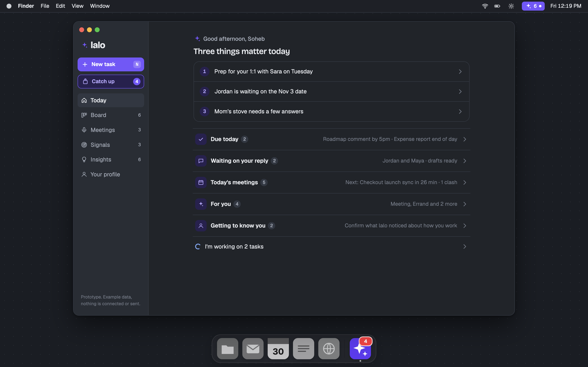
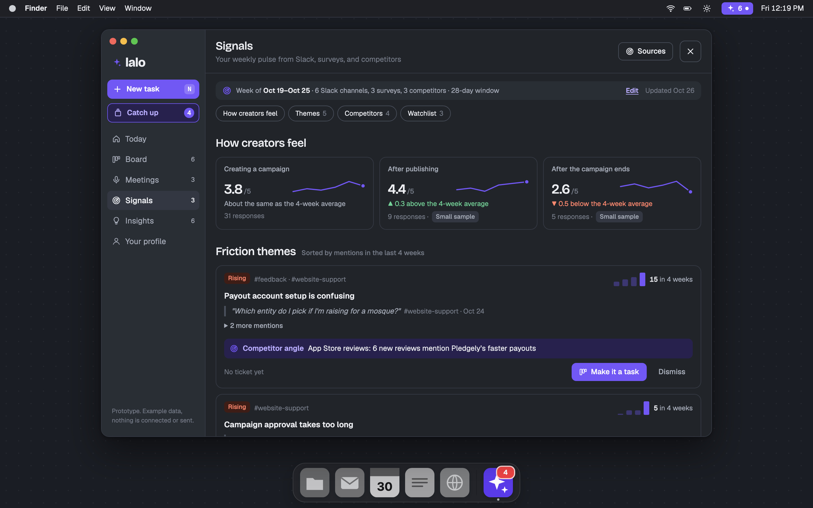
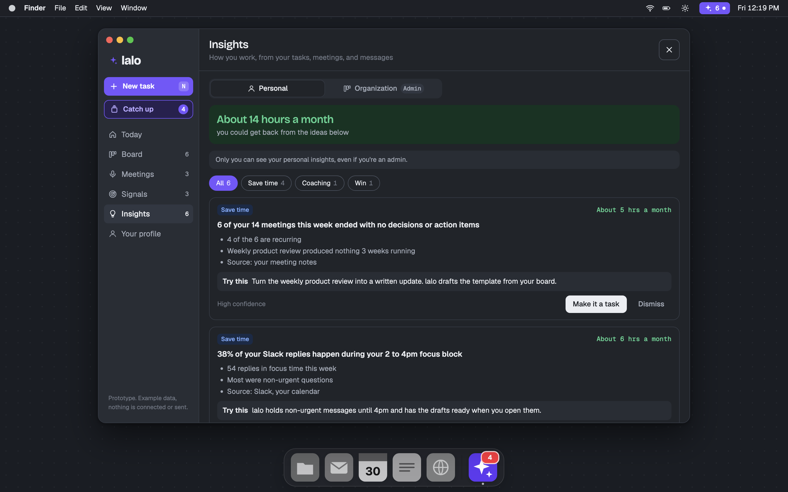

# lalo

A proactive work assistant that lives in the Mac menu bar. It reads your work across Slack, your calendar, meeting notes, Notion, Linear, and email. Then it tells you what matters today and gets the work ready before you ask.

Tell it anything, and it turns it into a task with a plan. Each step is tagged:

- **AI**: lalo does it on its own.
- **AI helps**: lalo drafts, researches, or prepares it, and you finish it.
- **You**: a clear next action for you.

Anything that goes out (a message, a comment, a report, a payment) always waits for your approval.

## Try it

Open the prototype at [svahora.github.io/lalo/prototype](https://svahora.github.io/lalo/prototype/), or open `prototype/index.html` in a browser. It is one file and uses example data only. Nothing is connected or sent.

The prototype opens as a **new user**, at the start of setup. To see the app as an **existing user**, use the **Prototype view** switch in the center of the menu bar. On a phone, the switch is at the bottom of Profile.

To open a page directly as an existing user, add `?view=` to the link, for example [`?view=signals`](https://svahora.github.io/lalo/prototype/?view=signals). It works with `today`, `board`, `meetings`, `signals`, `insights`, and `profile`.

## Top features

### 1. Today: one place to start your day

lalo speaks first. It shows the three things that matter most, and it has the work ready before you get to it.

- **Due today:** lalo drafts the work for you. For example, it suggests a comment for a doc and builds an expense report from your receipts.
- **Waiting on your reply:** who asked, where, how long they have waited, and a draft that is ready.
- **Today's meetings:** prep notes for each meeting, a tag when two meetings clash, and a note when no past notes were found.
- Each section is one row with a short summary. Click a row to open it in a side panel.

### 2. Signals: what users and competitors are telling you

A weekly pulse from your Slack channels, surveys, and competitor sites.

- **How creators feel:** survey scores with a trend line, compared with the 4-week average. Small samples are flagged.
- **Friction themes:** repeated problems from Slack, with mentions per week, real quotes, and the competitor move each one relates to.
- **Watchlist:** single mentions that aren't a theme yet. Make one a theme or drop it.
- **Sources:** choose the Slack channels, the competitors and pages to watch, the surveys, and the schedule.

### 3. Insights: ways to get your time back

lalo looks at how you work and suggests changes, with the time each one could save.

- **Personal:** for example, meetings that end with no decisions, or replies that interrupt your focus time. Only you can see these.
- **Organization (admin):** patterns across teams, with the hours or money each idea could save.
- Turn any idea into a task with one click.

## Everything else in the prototype

### Getting started
- **Setup in six steps:** welcome, connect your tools, watch lalo read in, confirm what it learned about you, choose how it checks in, then open Today.
- **Get started checklist** on Today for new users: approve a draft, add a task, and try "Hey lalo".

### Menu bar
- A quick recap that changes with the time of day. Step through items with Next.
- Add a task or ask a question. Click the mic, or say "Hey lalo".
- Today's meetings, with a countdown to the next one.

### Tasks
- **Board:** Needs you, Agent working, and Done.
- **New task** from any page (or press N). lalo plans it with you before it starts.
- **Catch up** in the sidebar opens the next item that needs you.
- **Task details** in a side panel: reply drafts in your voice, a code change with screenshots to approve, a personal errand, and 1:1 prep.

### Meetings
- **Coming up:** grouped by day, with time ranges and a countdown to the next meeting.
- **A nudge to record** when a meeting starts.
- **Past meetings:** notes you can edit in markdown, action items, and the transcript.
- **Ask this meeting:** ask a question, and the answer quotes the transcript.

### Also
- A profile of you that you can read and edit.
- Light and dark mode, and a phone layout.

## Plan for v1 (personal use)

- SwiftUI menu bar app, built with Swift Package Manager
- Local SQLite store
- Each task runs `claude -p` in the background, using your Claude login and connectors (Slack, Linear, Notion, Granola, Google Drive)
- Sending and buying tools are blocked. Drafts stay in lalo until you approve them
- Reply radar: finds Slack messages that need your reply and drafts answers in your voice
- Phone capture: messages to yourself in Slack that start with `+` become tasks
